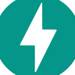
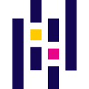

# 👋 Karol Karnas

**`Full-stack Engineer · Data Analysis · Agentic AI`**

_From client requirements to production._

**Backend systems · Modern interfaces · AI integrations**

I work with clients to turn requirements into working software: Python and Django backends, React and Next.js interfaces, AI integrations, testing, and deployment. I bring a strong backend foundation and stay involved from the client conversation through implementation and release.

<strong>Current professional projects:</strong>

<ul>
  <li><strong><a href="https://www.karnas.dev/professional-projects/dms-housing-authority">Housing Platform for HOME</a></strong> - Full-stack engineer at Kruko on a team building a housing operations platform for HOME in El Paso, Texas. My contribution spans Django APIs, integrations, recertification workflows, resident portals, caseworker tools, testing, and delivery. Document management (DMS) and AI-assisted processing are part of the wider platform · Django · Celery · React · Next.js · Azure</li>
  <li><strong><a href="https://databidmachine.com/">Data Bid Machine</a></strong> - Backend and AI integration work for a Google Ads platform: campaign reporting, budget monitoring, keyword analysis, and validated LLM recommendations for paid-search teams · Django · Celery · OpenAI · sentence-transformers · Pandas · AWS</li>
</ul>

I connect data and business rules to the interfaces people use, then verify the finished feature through tests and real user flows.

I use coding assistants for implementation, exploration, and review. I define the scope, make the technical decisions, review changes, and verify behavior. Responsibility for the delivered software stays with me.

---

<strong>Side projects:</strong>

<ul>
  <li><strong><a href="https://brain.karolkarnas.com/">The Brain</a></strong> — knowledge platform with semantic search · Django · pgvector · sentence-transformers · Celery · Redis · Tailwind</li>
  <li><strong><a href="https://www.karnas.dev/">karnas.dev</a></strong> — portfolio + blog · Next.js · React · TypeScript · SCSS</li>
  <li><strong><a href="https://www.ilustrografia.com/">ilustrografia.com</a></strong> — eCommerce full-stack · Node.js · Express · MongoDB · TypeScript · React · Redux · Tailwind</li>
</ul>

---

## 🔧 Technologies & Tools

**Backend & Infrastructure**

<table>
  <tr>
    <td align="center" height="144" width="144">
      
       <strong style="display:inline-block; width:84px; text-align:center;">Python</strong>
    </td>
    <td align="center" height="144" width="144">
      
       <strong style="display:inline-block; width:84px; text-align:center;">Django</strong>
    </td>
    <td align="center" height="144" width="144">
      
       <strong style="display:inline-block; width:84px; text-align:center;">FastAPI</strong>
    </td>
    <td align="center" height="144" width="144">
      
       <strong style="display:inline-block; width:84px; text-align:center;">Celery</strong>
    </td>
    <td align="center" height="144" width="144">
      
       <strong style="display:inline-block; width:84px; text-align:center;">Pandas</strong>
    </td>
    <td align="center" height="144" width="144">
      
       <strong style="display:inline-block; width:84px; text-align:center;">pytest</strong>
    </td>
    <td align="center" height="144" width="144">
      
       <strong style="display:inline-block; width:84px; text-align:center;">Jupyter</strong>
    </td>
  </tr>
  <tr>
    <td align="center" height="144" width="144">
      
       <strong style="display:inline-block; width:84px; text-align:center;">AWS</strong>
    </td>
    <td align="center" height="144" width="144">
      
       <strong style="display:inline-block; width:84px; text-align:center;">Azure</strong>
    </td>
    <td align="center" height="144" width="144">
      
       <strong style="display:inline-block; width:84px; text-align:center;">Docker</strong>
    </td>
    <td align="center" height="144" width="144">
      
       <strong style="display:inline-block; width:84px; text-align:center;">Postgres</strong>
    </td>
    <td align="center" height="144" width="144">
      
       <strong style="display:inline-block; width:84px; text-align:center;">SQL</strong>
    </td>
    <td align="center" height="144" width="144">
      
       <strong style="display:inline-block; width:84px; text-align:center;">Redis</strong>
    </td>
    <td align="center" height="144" width="144">
      
       <strong style="display:inline-block; width:84px; text-align:center;">Linux</strong>
    </td>
  </tr>
</table>

**Frontend & Interfaces**

<table>
  <tr>
    <td align="center" height="144" width="144">
      
       <strong style="display:inline-block; width:84px; text-align:center;">TypeScript</strong>
    </td>
    <td align="center" height="144" width="144">
      
       <strong style="display:inline-block; width:84px; text-align:center;">JavaScript</strong>
    </td>
    <td align="center" height="144" width="144">
      
       <strong style="display:inline-block; width:84px; text-align:center;">React</strong>
    </td>
    <td align="center" height="144" width="144">
      
       <strong style="display:inline-block; width:84px; text-align:center;">Next.js</strong>
    </td>
    <td align="center" height="144" width="144">
      
       <strong style="display:inline-block; width:84px; text-align:center;">Redux</strong>
    </td>
    <td align="center" height="144" width="144">
      
       <strong style="display:inline-block; width:84px; text-align:center;">Sass</strong>
    </td>
    <td align="center" height="144" width="144">
      
       <strong style="display:inline-block; width:84px; text-align:center;">Tailwind</strong>
    </td>
  </tr>
</table>

<strong>AI / LLM</strong>

  
  
  
  
  
  

<strong>Observability</strong>

  
  
  
  
  

